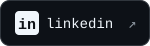

  

  
  
  

 

### `[01]` ~/stack

 

### `[02]` ~/projetos

 

### `[03]` ~/motion

> reel em breve. [ver trabalhos de motion ↗](https://www.instagram.com/lucas__pedrozo)

 

  <code>$ echo "obrigado por passar por aqui"</code>

